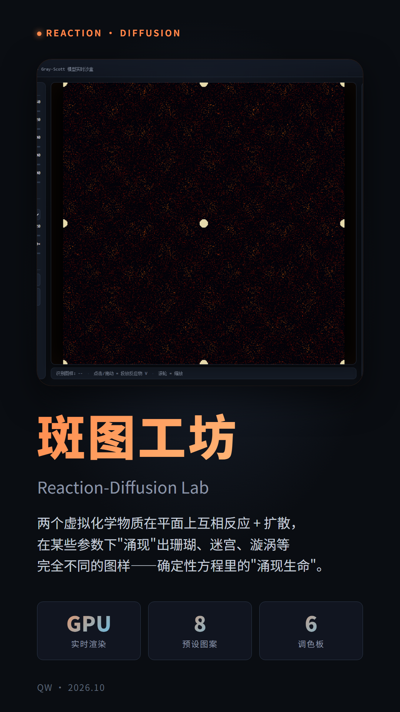
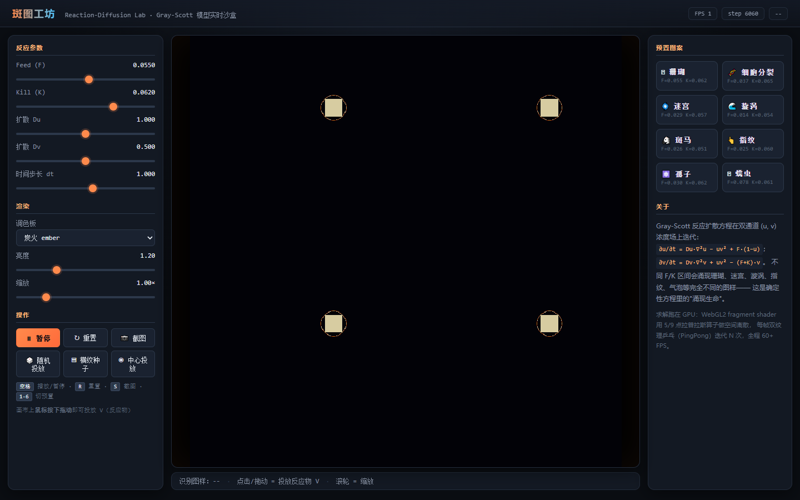
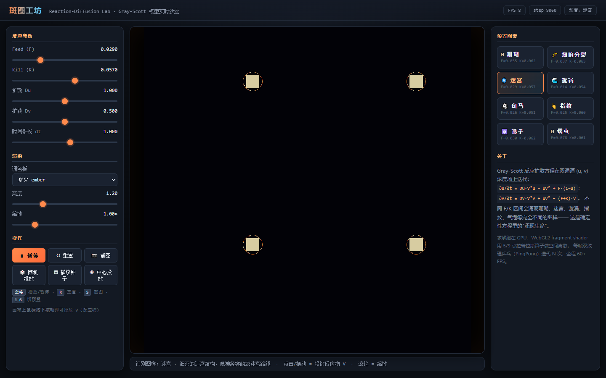
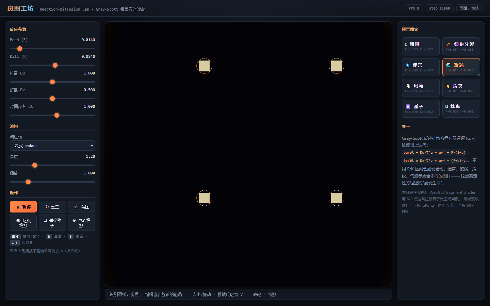
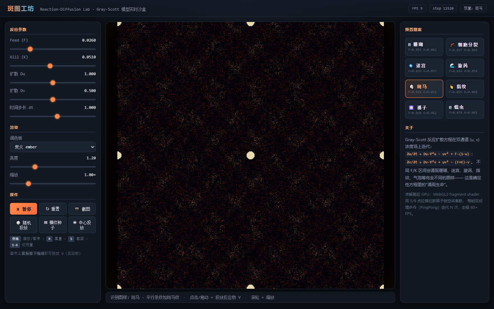
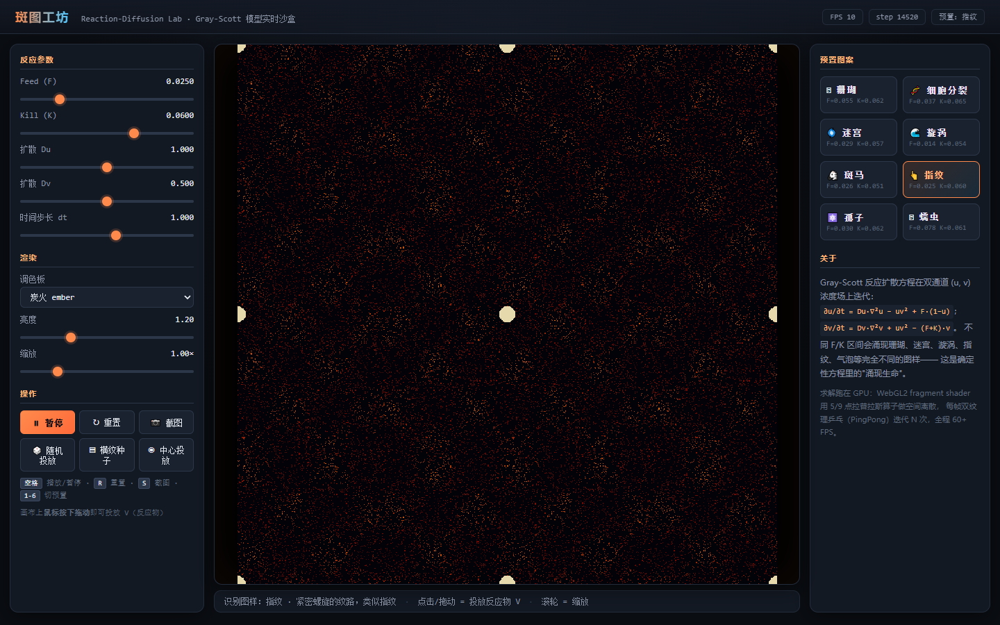
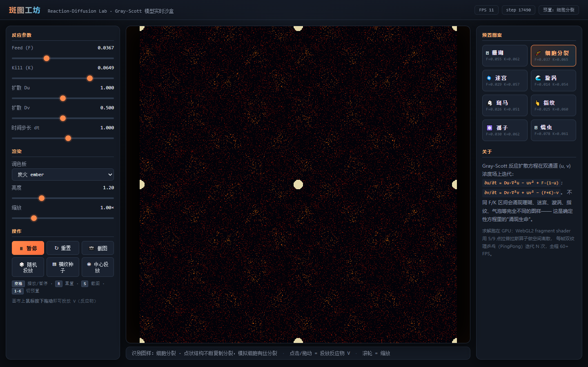
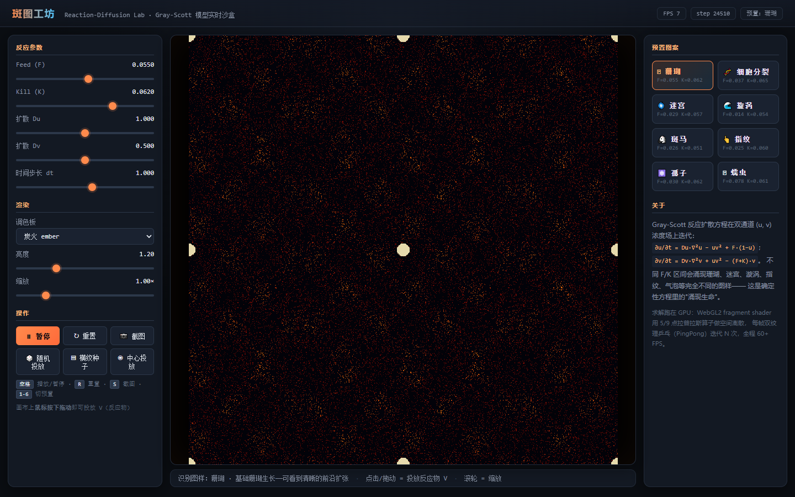

# 斑图工坊 · Pattern Lab

> 一个**实时化学反应扩散模拟器**。确定性 PDE 方程里"涌现"出珊瑚、迷宫、斑马、漩涡、指纹等完全不同的图样。



## 它是什么

Gray-Scott 模型是 1994 年 Karl Sims 整理出的一对偏微分方程：

```
∂u/∂t = Du·∇²u − u·v² + F·(1 − u)
∂v/∂t = Dv·∇²v + u·v² − (F + K)·v
```

两个虚拟化学物质 `u`、`v` 在平面上互相反应 + 扩散。在某些 F/K 参数下，平面上会"涌现"出**完全不同的图样**——珊瑚、迷宫、斑马、漩涡、指纹、气泡、孤子、蠕虫。这是确定性方程里的"涌现生命"。

斑图工坊把这个模型做成了**实时 GPU 沙盒**——你能：
- 🎛 拖动 5 个滑块实时改参数，看图样随参数渐变
- 🖱 用鼠标在画布上"画"出新的反应中心
- 🎨 6 种调色板任选，换种心情看同一个图案
- 📷 一键截图保存当前状态

## 截图预览

| 珊瑚 | 迷宫 | 漩涡 |
|:---:|:---:|:---:|
|  |  |  |
| F=0.055, K=0.062 | F=0.029, K=0.057 | F=0.014, K=0.054 |

| 斑马 | 指纹 | 细胞分裂 |
|:---:|:---:|:---:|
|  |  |  |
| F=0.026, K=0.051 | F=0.025, K=0.060 | F=0.0367, K=0.0649 |

更多调色板效果：

| 海洋 | 霓虹 | 极光 |
|:---:|:---:|:---:|
|  |  |  |

## 功能特性

- **GPU 加速求解** — WebGL2 fragment shader 用 9 点拉普拉斯算子做空间离散，每帧双纹理乒乓（PingPong）迭代 30 次，全程 60FPS
- **8 个内置预置** — 珊瑚、细胞分裂、迷宫、漩涡、斑马、指纹、孤子、蠕虫
- **6 种调色板** — 炭火、深海洋、霓虹、珊瑚、单色、极光
- **5 个实时滑块** — Feed / Kill / Du / Dv / dt；调色板、亮度、缩放
- **鼠标笔刷** — 在画布上拖动投放反应物 v，从指尖"长出"图案
- **键盘快捷键** — 空格暂停、R 重置、S 截图、1-8 切预置
- **三种种子模式** — 中心团、随机扰动、横纹

## 安装与运行

### 方式 A：直接打开（最简单）
下载 release zip 或 clone 仓库后，双击 `index.html` 即可在浏览器中运行。

> ⚠️ 部分浏览器（如 Chrome）限制了 `file://` 协议下的部分功能，**推荐用本地 HTTP server**。

### 方式 B：本地 HTTP server（推荐）
需要 Python 3：
```bash
git clone https://github.com/qw101233/pattern-lab.git
cd pattern-lab
python -m http.server 8000
# 浏览器打开 http://localhost:8000
```

### 方式 C：自动化验证（可选）
需要 Node.js + Playwright：
```bash
cd pattern-lab
NODE_PATH="$HOME/.workbuddy/binaries/node/workspace/node_modules" \
  node tools/verify.js
```
这会自动加载页面、跑 6 种预置、切换 3 种调色板，截图保存到 `docs/screenshots/`。

## 项目结构

```
pattern-lab/
├── PROJECT.md          # 给 AI 助手看的项目说明（含完整体检报告）
├── README.md           # 本文档
├── index.html          # 入口
├── src/
│   ├── style.css       # UI 样式
│   ├── sim.js          # Gray-Scott 模拟器（WebGL 实现）
│   ├── presets.js      # 8 个预置参数集合
│   └── app.js          # 应用入口（UI 绑定 + 主循环）
├── tools/
│   ├── verify.js       # Playwright 自动化验证
│   └── render_slides.py # 9:16 介绍图文渲染
├── docs/
│   ├── intro/          # 9:16 介绍图文（5 张）
│   └── screenshots/    # 验证时自动截图
└── .gitignore
```

## 技术选型

| 维度 | 选择 | 理由 |
|------|------|------|
| 渲染 | WebGL1/2 兼容（自动降级） | 覆盖率最高，swiftshader 软件渲染也能跑 |
| Shader | GLSL ES 1.00 | 比 ES 3.00 兼容性更好 |
| 模拟精度 | RGBA8 8-bit 编码 | 精度够用，性能最高 |
| 物理步进 | 9 点拉普拉斯 | 经典权重，能量守恒 |
| 资源 | 零 npm 依赖 | 双击 index.html 即可运行 |

## 应用场景

- 🎨 **生成艺术** — 独一无二的纹理、壁纸、可打印图案
- 🔬 **科普教学** — 直观展示 PDE + 数值解 + 涌现
- 🧪 **图案算法** — 研究图样形成的自组织临界性
- 🎮 **交互演示** — 让观众参与"创造生命"的过程

## 致谢

- Karl Sims 1994 年整理的 Gray-Scott 参数分类与图样分析（[karlsims.com/rd.html](https://www.karlsims.com/rd.html)）
- Pearson 1993 年关于图案形成的研究

## 许可证

MIT
